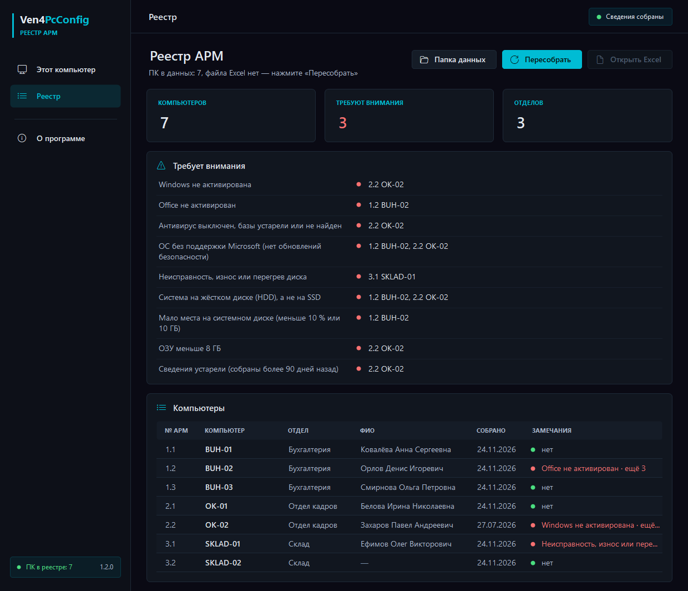

# ven4PcConfig

**Учёт рабочих мест (АРМ) в Excel за один запуск на каждом ПК.** Программа сама собирает железо, систему, активацию, антивирус, состояние дисков и установленные программы. Сисадмин вписывает отдел, номер АРМ и ФИО сотрудника, и всё сохраняется в общий реестр `Реестр_АРМ.xlsx`.

Из семейства [Ven4Tools](https://github.com/Ven4ru/Ven4Tools): то же оформление, тема «Бирюзовая».


## Возможности

- **Железо.** Процессор, модули ОЗУ с производителем и серийными номерами, материнская плата и BIOS, видеокарты с объёмом памяти, накопители (SSD/HDD, шина), мониторы по EDID (модель, диагональ, разрешение, серийный номер), сеть, принтеры.
- **Система.** Выпуск и сборка Windows, дата установки, пользователь, домен или рабочая группа, IP и MAC.
- **Лицензии.** Активирована ли Windows и Office (2010–2024, LTSC, Microsoft 365). Антивирус: включён ли, свежие ли базы, действует ли лицензия.
- **Здоровье дисков.** Исправность, прогноз отказа SMART, износ SSD, температура, наработка в часах.
- **Программы** — для всех пользователей ПК и для каждого пользователя отдельно.
- **Реестр в Excel из пяти листов:**
  - «Сводка» — что требует внимания, операционные системы, отделы;
  - «Реестр» — по отделам;
  - «Лицензии»;
  - «Комплектующие» с серийными номерами;
  - «Программы».
- **«Требует внимания»** подсвечивает ПК, у которых что-то не в порядке:
  - не активированы Windows или Office;
  - нет антивируса или устарели его базы;
  - ОС без поддержки Microsoft;
  - диск неисправен или изношен;
  - система стоит на HDD;
  - мало места на системном диске;
  - меньше 8 ГБ ОЗУ;
  - сведения устарели.
- **Повторный запуск** обновляет строку ПК, а не добавляет новую. Переименованный ПК узнаётся по UUID вместе с MAC-адресом или серийным номером.



## Что программа не собирает

- **Способ активации.** Не собираются ключи продуктов, канал (KMS/MAK/OEM/Retail) и адреса серверов активации, в реестре только «активировано» или «нет».
- **Личное содержимое.** Пароли, переписка, файлы пользователей и история браузера не читаются.
- **Сеть.** Программа ничего не отправляет: всё остаётся рядом с exe.

> ФИО, логины, IP и MAC в реестре — персональные данные. Храните реестр и папку `ven4PcConfig_данные` как документы с ограниченным доступом.

## Как пользоваться

1. Скачайте `ven4PcConfig.zip` из [Releases](../../releases) и распакуйте папку на флешку.
2. На каждом ПК запустите `ven4PcConfig.exe`. Сведения собираются сами, это занимает 3–10 секунд.
3. Заполните карточку АРМ: отдел (из списка или новый), номер (подсказывается по отделу), ФИО, при желании примечание. Нажмите **«Сохранить в реестр»**.
4. Реестр `Реестр_АРМ.xlsx` обновляется рядом с exe. Раздел «Реестр» в окне показывает все ПК и замечания.

Права администратора не обязательны. С ними программа дополнительно видит износ и температуру дисков, прогноз отказа SMART и программы других пользователей. Без прав в окне есть кнопка «Перезапустить от имени администратора».

Если реестр собирали на нескольких флешках, скопируйте XML-файлы в одну папку `ven4PcConfig_данные` и нажмите «Пересобрать» (или запустите с ключом `/rebuild`).

### Ключи командной строки

| Ключ | Что делает |
|---|---|
| (без ключей) | окно программы |
| `/auto` | собрать и сохранить без окна и вопросов: отдел, номер и ФИО берутся из прошлого запуска (для скриптов и групповых политик) |
| `/rebuild` | только пересобрать Excel из сохранённых данных |
| `/console` | работа в консоли с вопросами |
| `/nopause` | не ждать нажатия клавиши в конце (для консольных режимов) |

## Требования

- Windows XP SP2/SP3, Vista, 7, 8, 8.1, 10, 11 и серверные выпуски, 32 и 64 бита.
- Встроенный в Windows .NET Framework 2.0/3.5 или 4.x. Файл `ven4PcConfig.exe.config` рядом с exe позволяет запускаться на любом из них.

## Сборка

Нужен любой .NET SDK версии 6 и выше. Сборки .NET Framework 2.0 он подтягивает из NuGet сам.

```powershell
pwsh -File build.ps1
```

Результат — `dist\ven4PcConfig\` и `dist\ven4PcConfig.zip`.

Для проверки вида есть служебный ключ `/shot <папка>`: окно на выдуманных данных сохраняется снимками PNG, настоящие сведения о ПК при этом не используются.

## Устройство

| Файл | Что внутри |
|---|---|
| `src/Collector.cs`, `Licenses.cs`, `Native.cs`, `Hives.cs` | сбор сведений: WMI, реестр, SMBIOS, EDID, разделы реестра других пользователей |
| `src/Store.cs` | по одному XML на ПК, перевод данных старых версий |
| `src/Session.cs` | общая логика окна и консоли: сбор, поиск прежней записи, сохранение |
| `src/Program.cs`, `Summary.cs`, `Xlsx.cs` | реестр Excel без сторонних библиотек |
| `src/Gui/` | окно на WinForms в стиле Ven4Tools |
| `package/README.txt` | инструкция, которая кладётся рядом с exe |

## Лицензия

[MIT](LICENSE) © 2026 Ven4ru
